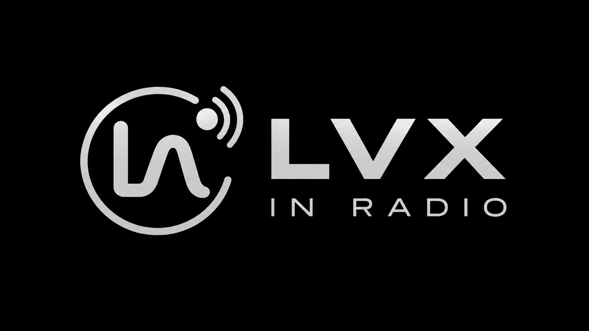

<h3 align="center">A radio station that composes itself, on your Mac.</h3>

https://github.com/user-attachments/assets/0f206c6e-dbc0-431f-83f9-1f97d99b9a27

<a href="https://github.com/lvxworld/lvx-in-radio/releases/latest"><b>Download for Mac</b></a>

Pick a mood, turn the dials, press Tune In. LVX in Radio writes a station just for you, one new song after another, while you listen. No playlists to build, nothing to skip through, and the music is made right there on your Mac.

## Why you'll love it

- **Music on from the first second.** The LVX stations are already on air when you open the app, so you have something to listen to while you create your own.
- **Stations that are yours.** Choose a scenario, mix up to five of thirteen genres, set the energy and give your station a name. Add your own words if you like, or go instrumental.
- **A radio, not a playlist.** Turn the FM dial and watch the light change with each station. New songs arrive by themselves, just before you need them.
- **It gets to know you.** Keep the songs you love and remove the ones you don't. Your stations remember.
- **Share a sound as a picture.** Every station has a Lux code: a living QR code made of dust. Send it, and a friend can tune in to the same sound.
- **Private by design.** Songs are composed on your Mac. No account, no subscription, no cloud generation.

## Get started

1. **[Download the app](https://github.com/lvxworld/lvx-in-radio/releases/latest)** and drag **LVX in Radio** into Applications.
2. **Open it.** macOS asks for approval the first time, because this free app isn't notarized by Apple: go to **System Settings → Privacy & Security → Open Anyway**.
3. **Listen, then create.** The app guides you through the one thing it needs, the music model (about 4.5 GB). It downloads, pauses and resumes by itself, and you can keep listening meanwhile.

There's nothing else to install.

**You need** a Mac with Apple Silicon and about 5 GB of free space. A new song takes a few minutes to compose, and more memory helps: 16 GB or more is what we'd suggest.

## The music is yours to use

LVX in Radio is powered by [YuE2](https://github.com/multimodal-art-projection/YuE) and [audio.cpp](https://github.com/0xShug0/audio.cpp).

- **If you make music as an individual,** you can use the model for free and publish, sell or otherwise monetize what you create, with no fees or royalties. Crediting YuE2 is welcome and optional.
- **If you're a company,** commercial use of the model needs a separate license from its authors.
- **Everyone** agrees to use it responsibly: nothing illegal, harmful or deceptive.

The model isn't part of the download: you accept its terms inside the app before getting it. In full, the YuE2 weights are [CC BY-NC 4.0 with an additional creator permission](https://github.com/multimodal-art-projection/YuE/blob/main/MODEL_LICENSE), and audio.cpp is Apache 2.0. This is a summary, not legal advice: the linked license is what counts.

---

Want to build it yourself or help out? See <a href="DEVELOPMENT.md">DEVELOPMENT.md</a>.

